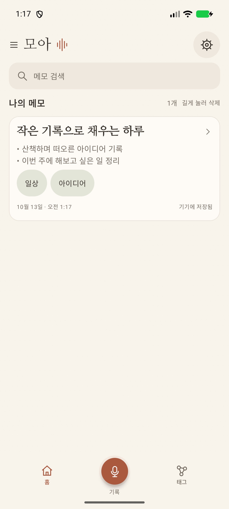
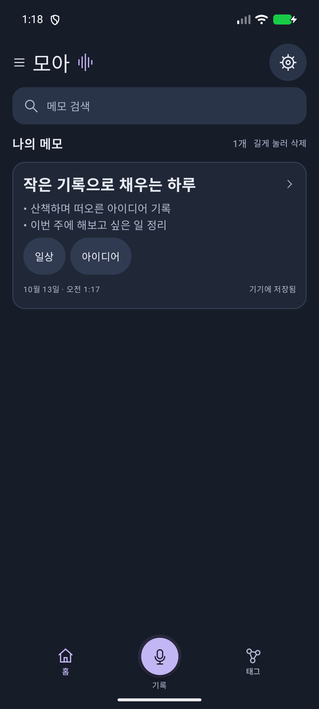
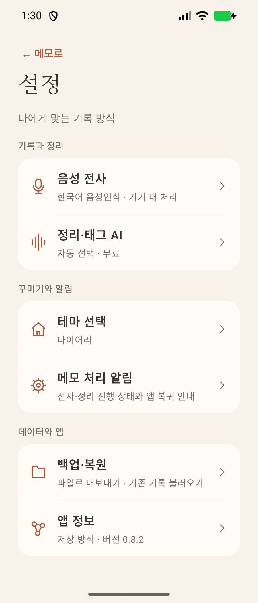

# 모아

### 작은 목소리도, 소중한 기록이 되니까.

말로 남기고 · 핵심으로 정리하고 · 태그로 다시 만나는 나의 생각

**Android · v0.8.2 · 로컬 저장 · 5가지 테마**

[**↓ 설치 APK 다운로드**](https://github.com/dei-day/moa/releases/tag/v0.8.2) &nbsp; · &nbsp; [변경 내역](CHANGELOG.md) &nbsp; · &nbsp; [의견 남기기](https://github.com/dei-day/moa/issues)

---

## 생각을 놓치기 전에, 기록 한 번

산책 중 떠오른 아이디어, 잊기 쉬운 할 일, 오늘의 짧은 회고까지. **모아**는 음성을 텍스트로 옮기고 AI가 제목·핵심 메모·태그로 정리해 주는 Android 메모 앱입니다. 갤럭시 폴드의 커버 화면과 펼친 화면을 우선으로 설계했습니다.

**① 기록** → **② 기기에서 전사** → **③ AI로 핵심 정리** → **④ 폴더와 태그로 보관**

<table>
<tr><th>따뜻한 기록</th><th>차분한 밤</th><th>간결해진 설정</th></tr>
<tr><td></td><td></td><td></td></tr>
</table>

예시 메모를 사용한 앱 화면입니다. 기기와 화면 크기에 따라 배치가 달라질 수 있습니다.

## 기록에 필요한 것만, 편안하게

| 기능 | 모아에서 할 수 있는 일 |
| :--- | :--- |
| 🎙️ 음성 기록 | 녹음 팝업에서 시작·종료·취소, 한국어 전사 |
| ✨ AI 정리 | 긴 문장을 핵심별 글머리표 메모로 정리하고 제목 생성 |
| 🏷️ 핵심 태그 | 대분류·중분류와 필요한 세부 분류로 정리 |
| 🕸️ 생각의 연결 | 함께 쓰인 태그를 입체 그래프로 탐색, 두 손가락 회전·확대 |
| 📁 나만의 정리 | 폴더 생성·이동, 제목·본문·태그를 상세 화면에서 바로 편집 |
| 🎨 다섯 가지 분위기 | 다이어리 · 화이트 · 세이지 · 미스트 · 미드나이트 |
| 🔔 진행 알림 | 전사·AI 정리 단계와 앱 복귀가 필요한 상태 안내 |
| 💾 내 손으로 백업 | 원하는 폴더에 `.moabackup` 파일로 내보내기·복원 |

## 처음 사용하기

1. [v0.8.2 Release](https://github.com/dei-day/moa/releases/tag/v0.8.2)에서 **`moa-voice-notes-0.8.2.apk`**를 내려받아 설치합니다.
2. 첫 실행 안내에 따라 마이크 권한과 전사 지원 상태를 확인합니다.
3. **설정 → 정리·태그 AI**에서 사용 가능한 모델을 준비합니다.
4. 아래 **기록** 버튼을 누르고 말한 뒤, 녹음을 종료하면 메모 정리가 시작됩니다.
5. **설정 → 백업·복원**에서 기록을 파일로 보관할 수 있습니다.

### AI는 내 환경에 맞게

| 선택 | 처리 위치 | 준비 사항 |
| :--- | :--- | :--- |
| 자동 선택 | 기기 내 | 준비된 내장 AI 또는 다운로드 모델 사용 |
| 내장 Gemini Nano | 기기 내 | AICore·기기 지원 확인 및 최초 모델 준비 필요 |
| 다운로드 모델 | 기기 내 | 모델 다운로드를 위한 저장 공간·메모리 필요 |
| ChatGPT | 온라인 | 계정 연결·인터넷 필요, 계정 사용 한도 적용 |

기기 내 모델은 정리할 때 외부 AI 계정이 필요하지 않습니다. 모델의 최초 준비·다운로드에는 인터넷이 필요할 수 있습니다. **설치 직후 모든 기기에서 Gemini Nano를 바로 사용할 수 있는 것은 아닙니다.** 설정에서 지원 상태를 확인해 주세요.

전사는 Android의 기기 내 음성 인식 기능을 사용합니다. 실제 지원 여부는 OS·음성 인식 서비스·한국어 모델 준비 상태에 따라 달라집니다. Fold 8을 우선 지원 대상으로 개발 중이며, 모든 기기에서 동일한 동작을 보장하지 않습니다.

## 내 기록은 어디에 저장되나요?

- 메모·전사문·태그·폴더는 기기에 저장됩니다.
- 전사문이 저장되면 녹음 원본은 자동 삭제됩니다. 전사 실패 시에는 재시도를 위해 보관합니다.
- 로컬 백업으로 다른 기기로 옮기거나 재설치 후 복원할 수 있습니다. AI 모델과 로그인 정보는 백업에 포함하지 않습니다.
- **현재 버전의 클라우드 동기화 메뉴와 자동 동기화는 숨김 상태입니다.** 후속 버전에서 공개할 예정입니다.
- AI 정리 결과는 원문과 다를 수 있으며 직접 편집할 수 있습니다. 내장 AI가 백그라운드에서 대기하면 앱으로 돌아올 때 이어서 처리합니다.

## 현재 버전

**0.8.2 · 설정을 더 짧고 명확하게**

기록과 정리 / 꾸미기와 알림 / 데이터와 앱 — 세 그룹, 여섯 메뉴로 설정을 재구성했습니다. 원하는 기능으로 바로 들어가고 뒤로 돌아올 수 있습니다.

| 확인 항목 | 결과 |
| :--- | :--- |
| 앱 버전 | 0.8.2 · versionCode 37 |
| APK | 약 86.2 MB · Android Debug 서명 빌드 |
| 단위 테스트 | 250개 통과 |
| 설정 화면 검증 | 커버·넓은 화면 에뮬레이터에서 6개 메뉴 및 뒤로 이동 확인 |
| 다음 방향 | 실제 기기 피드백 반영 · AI 정리 안정화 · 클라우드 연동 후속 공개 |

현재 APK는 개발·테스트 배포 빌드입니다. 자동 업데이트 기능은 없으며 새 Release의 APK를 직접 설치합니다. 업데이트 전 로컬 백업을 권장합니다.

## 버전과 소스

- **설치 파일 / 소스 묶음 / 체크섬**: [Releases](https://github.com/dei-day/moa/releases)
- **개발 변경 이력**: [CHANGELOG.md](CHANGELOG.md)
- **소스 빌드 안내**: [BUILD.md](BUILD.md)

이 저장소의 첫 화면은 소개·배포 문서로 구성되어 있습니다. **앱 전체 소스는 Release의 `moa-source-0.8.2.zip`에 포함**되어 있습니다. GitHub가 자동으로 만드는 “Source code” 압축 파일은 이 소개 저장소의 파일이며 앱 전체 소스와 다릅니다.

---

**모아** — 마음에 남은 생각을, 오래 곁에.

