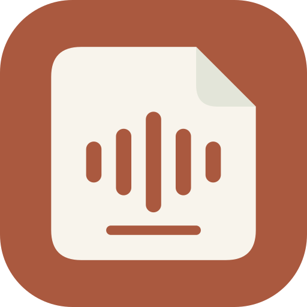
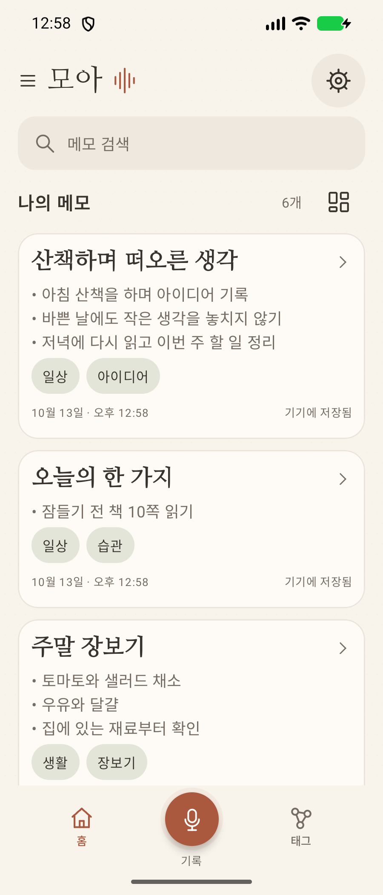
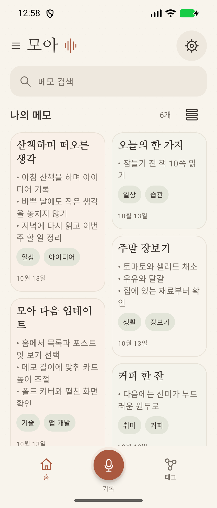
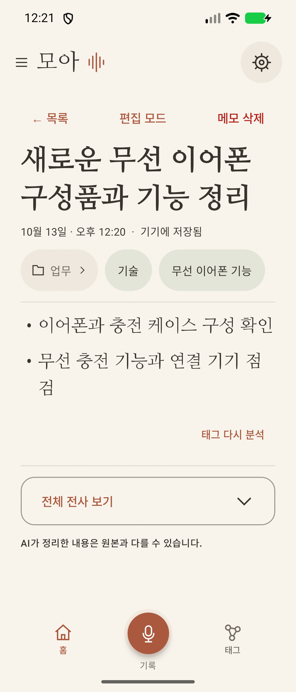
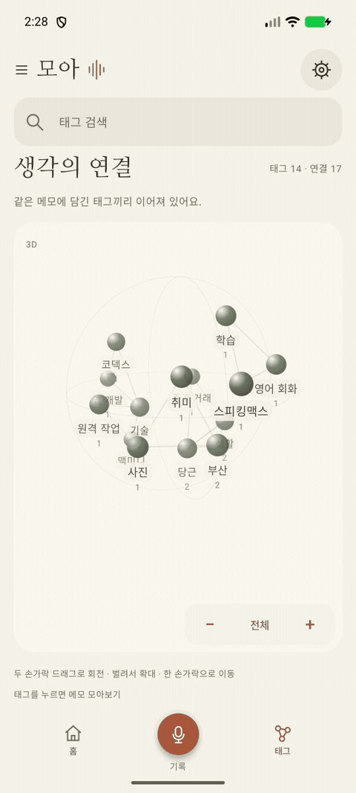

# 모아

### 작은 목소리도, 소중한 기록이 되니까.

말로 남기고 · 핵심으로 정리하고 · 태그로 다시 만나는 나의 생각

[**↓ 최신 APK 설치하기**](https://github.com/dei-day/moa/releases/latest) &nbsp; · &nbsp; [변경 내역](CHANGELOG.md) &nbsp; · &nbsp; [오류·아이디어 제안](https://github.com/dei-day/moa/issues)

---

산책 중 떠오른 아이디어, 잊기 쉬운 할 일, 오늘의 짧은 회고까지. **모아**는 음성을 텍스트로 옮기고 AI가 제목·핵심 메모·태그로 정리해 주는 Android 메모 앱입니다. 갤럭시 폴드의 커버 화면과 펼친 화면을 우선으로 설계했습니다.

**① 말로 기록 → ② 기기에서 전사 → ③ AI 핵심 정리 → ④ 폴더·태그로 보관**

## 내 기록을 보는 두 가지 방법

<table>
<tr><th>차곡차곡, 목록</th><th>한눈에, 포스트잇</th><th>내용에 집중하는 상세 화면</th></tr>
<tr><td></td><td></td><td></td></tr>
</table>

홈의 **메모 개수 옆 아이콘**으로 목록과 포스트잇 보기를 전환하세요. 포스트잇은 메모 길이에 맞춰 높이가 달라지고, 화면을 펼치면 더 많은 열로 표시됩니다. 선택한 보기는 앱을 다시 열어도 유지됩니다.

예시 메모를 사용한 앱 화면입니다. 화면 크기와 글자 설정에 따라 배치가 달라질 수 있습니다.

## 기록에 필요한 것만, 편안하게

| 기능 | 모아에서 할 수 있는 일 |
| :--- | :--- |
| 🎙️ 음성 기록 | 녹음 팝업에서 종료·취소, 기기 내 한국어 전사 |
| ✨ 핵심 메모 | AI가 제목을 만들고 핵심별 글머리표로 내용 정리 |
| 🏷️ 핵심 태그 | 대분류·중분류와 필요한 세부분류, 태그별 메모 모아보기 |
| 🕸️ 생각의 연결 | 함께 쓰인 태그를 3D 지도로 탐색, 두 손가락 회전·확대 |
| 📁 폴더와 편집 | 폴더 생성·이동, 제목·본문·태그를 상세 화면에서 바로 수정 |
| 🗂️ 보기 선택 | 목록·포스트잇 전환, 메모 검색과 길게 눌러 삭제 |
| 🎨 다섯 가지 테마 | 다이어리 · 미니멀 화이트 · 세이지 그린 · 미스트 블루 · 미드나이트 |
| 🔔 진행 알림 | 전사·AI 정리 단계와 앱 복귀가 필요한 상태 안내 |
| ⬆️ 새 버전 알림 | 앱을 열 때 GitHub 최신 릴리스 확인, 새 APK 공개 시 알림바에서 안내 |
| 💾 파일 백업 | 원하는 위치에 `.moabackup` 내보내기·복원, 폴더·태그 함께 보관 |

## 태그로 만나는 생각의 연결

같은 메모에 쓰인 태그끼리 선으로 이어집니다. 태그를 눌러 관련 메모를 모아보고, 두 손가락으로 지도를 돌려 새로운 연결을 살펴보세요. 큰 지도에서는 주요 이름·연결을 우선 표시하고, 확대하거나 검색하면 더 자세히 볼 수 있습니다. **목록** 버튼으로 모든 태그를 검색하고 선택할 수 있습니다.

회전 GIF는 이전 버전 화면입니다. 0.8.7에는 표시량 조절과 전체 태그 목록이 추가되었습니다.

## 처음 사용하기

1. [최신 릴리스](https://github.com/dei-day/moa/releases/latest)의 **`moa-voice-notes-0.8.7.apk`**를 내려받아 설치합니다.
2. 처음 실행하면 안내에 따라 마이크 권한과 기기 내 전사 지원 상태를 확인합니다.
3. **설정 → 정리·태그 AI**에서 사용할 모델을 준비합니다.
4. 아래 **기록** 버튼을 누르고 말한 뒤, 녹음을 종료하면 전사와 메모 정리가 시작됩니다.
5. **설정 → 백업·복원**에서 기록을 파일로 보관할 수 있습니다.

### AI는 내 환경에 맞게

| 선택 | 처리 위치 | 준비 사항 |
| :--- | :--- | :--- |
| 자동 선택 | 기기 내 | 준비된 내장 AI 또는 다운로드 모델 사용 |
| 내장 Gemini Nano | 기기 내 | 기기·AICore 지원 확인과 최초 모델 준비 |
| 다운로드 모델 | 기기 내 | 모델 다운로드를 위한 저장 공간·메모리 |
| ChatGPT | 온라인 | 계정 연결·인터넷, 연결한 계정의 사용 한도 적용 |

기기 내 모델로 정리할 때는 외부 AI 계정이 필요하지 않습니다. 최초 모델 준비·다운로드에는 인터넷이 필요할 수 있습니다. **설치 직후 모든 기기에서 Gemini Nano를 바로 사용할 수 있는 것은 아닙니다.** 설정에서 지원 상태와 모델 준비 여부를 확인해 주세요.

전사는 Android의 기기 내 음성 인식 기능을 사용합니다. 한국어 지원은 OS·음성 인식 서비스·음성 모델 준비 상태에 따라 달라집니다. 설치 가능한 최소 OS는 Android 9이며, 전사와 내장 AI의 실제 사용 조건은 기기마다 다릅니다.

## 기록과 백업

- 메모·전사문·태그·폴더는 기기에 저장됩니다. 기기 내 AI를 선택하면 전사문과 메모 정리도 기기 안에서 처리합니다.
- ChatGPT를 선택하면 정리에 필요한 전사문·메모 내용이 연결한 온라인 AI 서비스로 전송됩니다.
- 전사문이 저장되면 녹음 원본은 자동 삭제됩니다. 전사 실패 시에는 재시도를 위해 보관합니다.
- 로컬 백업으로 다른 기기로 옮기거나 재설치 후 복원할 수 있습니다. AI 모델과 로그인 정보는 백업에 포함하지 않습니다.
- 클라우드 동기화는 후속 공개 예정이며, 현재 배포 버전에서는 파일 백업·복원을 사용합니다.
- AI 정리 결과는 원문과 다를 수 있어 직접 편집할 수 있습니다. 내장 AI가 백그라운드에서 대기하면 앱으로 돌아올 때 이어서 처리합니다.

## 최신 버전 · 0.8.7

**태그가 많아져도 더 가볍게 살펴보는 생각의 연결**

- 3D 지도 회전 계산 개선, 이동·확대 시 계산 결과 재사용
- 회전할 때 글자를 다시 배치하는 작업을 줄이고 큰 지도에서는 겹치는 이름을 정리
- 확대 수준에 따라 주요 이름·연결을 더 표시하고, 전체 태그는 점·검색·목록으로 탐색
- 검색한 태그를 우선 표시하고 전체 목록에서 원하는 태그의 메모 열기
- 지도 집계·검색·초기 배치를 백그라운드에서 준비

| 확인 항목 | 결과 |
| :--- | :--- |
| 버전 | 0.8.7 · versionCode 42 |
| 설치 파일 | Android Debug 서명 · 기존 인증서 유지 |
| 단위 테스트 | 275개 통과 |
| 태그 지도 UI 검사 | 커버 25개 · 펼친 화면 25개 통과 |
| 대량 데이터 검사 | 가상 메모 1천~10만 개 · 태그 100~1만 개로 CPU 계산 비교 |

UI 검사는 에뮬레이터에서 진행했으며, 대량 데이터 계산 시간은 실제 휴대폰의 화면 FPS 측정값이 아닙니다. 태그·연결 데이터는 보존하고 화면에 표시하는 이름과 선만 조절합니다.

현재는 **공개 테스트 배포**입니다. 다양한 실기기에서의 확인은 계속 진행합니다. 새 버전을 알림으로 안내하며, APK 설치는 사용자가 직접 진행합니다. 기존 버전은 앱을 삭제하지 않고 업데이트 설치할 수 있습니다. 업데이트 전 **설정 → 백업·복원**에서 파일 백업을 만들어 두세요.

## 의견을 들려주세요

[GitHub Issues](https://github.com/dei-day/moa/issues)에 오류나 원하는 기능을 남겨 주세요. 오류 제보에는 **앱 버전, 휴대폰 모델·Android 버전, 사용한 AI 모델, 재현 순서**를 함께 적으면 확인에 도움이 됩니다. 화면이나 전사문을 첨부할 때는 개인 정보가 들어 있지 않은지 확인해 주세요.

## 버전과 소스

- **APK / 앱 소스 묶음 / 체크섬**: [Releases](https://github.com/dei-day/moa/releases)
- **선택한 배포 버전의 변경 사항**: [CHANGELOG.md](CHANGELOG.md)
- **빌드 환경과 서명 안내**: [BUILD.md](BUILD.md)

이 레포는 소개·배포 문서로 구성되어 있습니다. **앱 전체 소스는 릴리스의 `moa-source-0.8.7.zip`**에 포함됩니다. GitHub 자동 생성 “Source code” 압축 파일은 이 소개 레포의 파일입니다. 소스 재배포 라이선스는 아직 지정하지 않았습니다.

---

**모아** — 마음에 남은 생각을, 오래 곁에.

